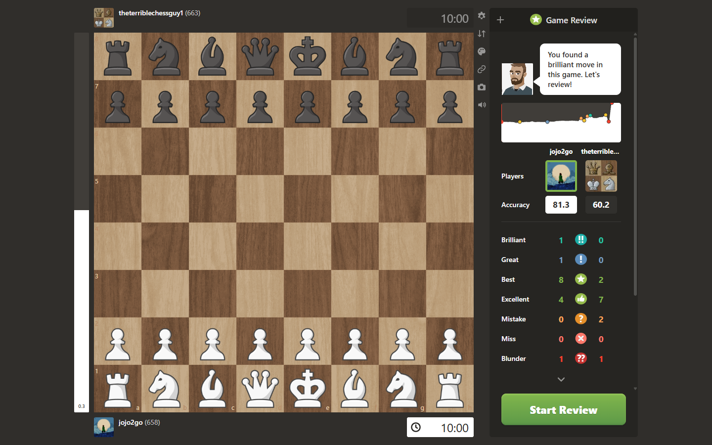
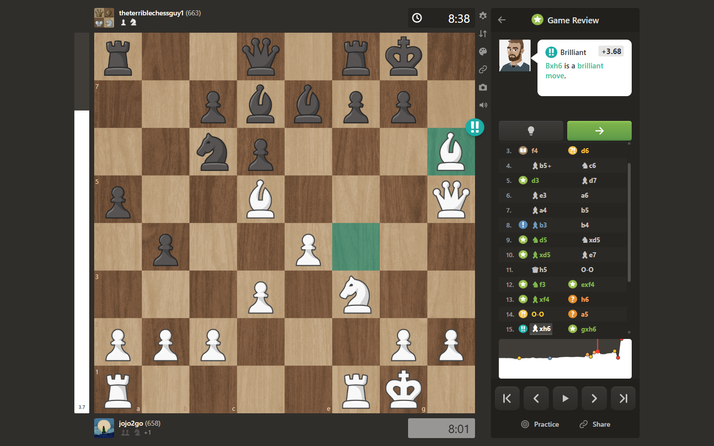
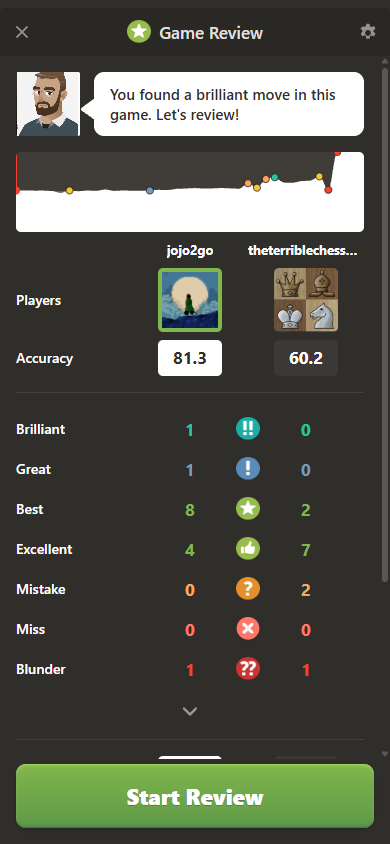
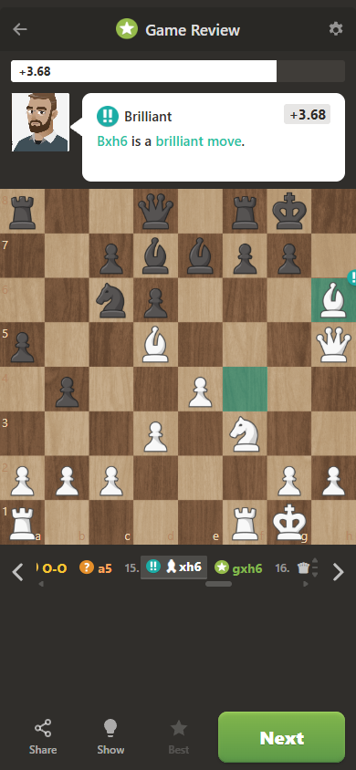

# Chess Game Review

A tool that analyzes your chess games — similar to chess.com's "Game Review" feature. It shows you which moves were good, which were bad, where you went wrong, and how to improve. Stockfish runs right in your browser, so there's no account and no daily review limit.

**Try it:** [chess-game-review-drab.vercel.app](https://chess-game-review-drab.vercel.app)

<p align="center">
  
</p>

<p align="center">
  
</p>

<p align="center"><em>15.Bxh6!! — a bishop sacrifice on h6 that opens Black's king, rated Brilliant in the guided review.</em></p>

<p align="center">
  
  &nbsp;
  
</p>

<p align="center"><em>On phones the layout follows the chess.com app.</em></p>


---

## Quick Start (recommended for most people)

The fastest way to use this tool is the Chrome extension by itself — no installs, no terminal, no Node.js. Analysis runs in a hosted version of the app, so you just need the extension.

1. Download the `extension/` folder from this project
2. Open `chrome://extensions` in Chrome
3. Turn on **"Developer mode"** in the top right
4. Click **"Load unpacked"** and select the `extension/` folder
5. Finish a game on chess.com and click **♞ Partie analysieren** in the game-over window or the sidebar (or the extension icon) — the game opens automatically in the analysis tool

There's also an even simpler option without an extension at all: a so-called **bookmarklet** (a bookmark with built-in functionality). Details in [`extension/README.md`](extension/README.md).

> The extension sends games to a hosted instance of this app by default. If you'd rather run your own private, independent copy, see **Self-Hosting** below.

---

## On iPhone

No extension needed: add the app to the Home Screen and just open it — it loads and analyzes your newest game by itself, or load another with **Paste link**. An iOS Shortcut also puts **Analyze game** into the chess.com app's share sheet: it sends the game as a notification, and one tap opens it in the app. On phones the board sits above the analysis. Setup: [`docs/iphone.md`](docs/iphone.md).

---

## Self-Hosting (optional, for your own independent copy)

Run the tool entirely on your own computer instead of using the hosted version. Useful if you want to work offline, keep everything private, or just don't want to depend on someone else's server. No programming knowledge required — just follow these steps in order.

### Step 1 — Install a small helper program (Node.js)

1. Open [nodejs.org](https://nodejs.org)
2. Download the version labeled **"LTS"** (this is the recommended, stable version)
3. Install it like any other program (just click "Next")

### Step 2 — Download the project

Download this project folder (e.g. via the green "Code" button on GitHub → "Download ZIP") and unzip it anywhere on your computer.

### Step 3 — Start the tool

1. Open the unzipped folder
2. Open a terminal window inside it (right-click in the folder → "Open Terminal here" / "Open in Terminal")
3. Type the following command and press Enter — this downloads everything the tool needs, once:
   ```
   npm install
   ```
4. Then start the tool with:
   ```
   npm run dev
   ```
5. An address like `http://localhost:5173` will appear — open it in your browser

The tool is now running locally on your machine. You can paste a game as PGN (that's the text export of a chess game) and the analysis starts automatically (you can turn that off in the ⚙ settings). Games you've analyzed before open instantly, because results are cached in your browser.

> Once you're done, just close the terminal window to stop the tool.

### Step 4 — Point the extension at your local copy

By default, the extension sends games to the hosted version of the app. To use your own local copy instead:

1. Load the extension as described in **Quick Start** above
2. Open the extension popup on chess.com
3. Replace the URL field with `http://localhost:5173`
4. Make sure the tool from Step 3 is still running whenever you use the extension

---

## What you'll see in the analysis

- **Move ratings** — every move gets a label, from Brilliant (!!) and Great (!) through Best, Excellent and Good down to Inaccuracy, Mistake, Miss and Blunder
- **Guided review** — step through the game with a coach who says what each move did and shows the engine's best move
- **Evaluation graph and bar** — when the game swung in whose favor
- **Accuracy % and game rating** — how precisely each side played overall
- **Opening recognition** — which known opening was played
- **Retry and practice** — try a better move at the critical moments, or play the position out against the engine
- **Puzzles from your own mistakes** — your Mistakes, Misses and Blunders become puzzles to solve
- **Share links** — every game and move has its own link (`?game=…&move=…`)
- **Themes** — board and piece styles to choose from

---

## For developers

<details>
<summary>Show technical details</summary>

### Tech Stack

- **Frontend:** React 19 with TypeScript, built with Vite
- **Board:** react-chessboard
- **Chess logic:** chess.js (move validation, PGN parsing)
- **Engine:** Stockfish 18 (WebAssembly, runs in a Web Worker)
- **Charts:** Recharts
- **Styling:** Tailwind CSS
- **Tests:** Vitest

### Architecture

Two strictly separated layers:

1. **Engine layer** — Stockfish WASM evaluates positions deterministically, no LLM involved
2. **UI layer** — React components for board, evaluation, graphs, move list


### Useful commands

```bash
npm run dev     # start dev server
npm run build   # create production build
npm run lint    # run linter
npm test        # run tests
```

### Project structure

```
├── src/
│   ├── components/        # React components (board, summary, review, puzzles, ...)
│   ├── lib/
│   │   ├── analysis/      # Analysis logic (classification, accuracy, coach text, puzzles)
│   │   └── engine/        # Engine communication and Web Worker
│   ├── hooks/             # Custom hooks (useGame, usePuzzles, useSettings, ...)
│   ├── data/               # Static data (openings database)
│   ├── App.tsx
│   └── main.tsx
├── public/
│   ├── engine/             # Stockfish WASM files
│   ├── pieces/             # Chess piece SVGs
│   ├── sounds/             # Move sounds
│   └── marks/              # Classification icons
├── api/                     # Serverless functions (chess.com game proxy, share push)
├── docs/                    # iPhone setup and README screenshots
├── extension/               # Browser extension and bookmarklet
├── Board&Game/              # Design assets
└── package.json
```

### Keyboard shortcuts

- **Left/Right arrow keys** — navigate between moves
- **Home/End** — jump to start/end of game

### Resources

- [Stockfish Documentation](https://stockfishchess.org/)
- [chess.js Documentation](https://github.com/jhlywa/chess.js)
- [React Documentation](https://react.dev/)
- [Tailwind CSS Documentation](https://tailwindcss.com/)
- [Lichess Opening Database](https://github.com/lichess-org/chess-openings)

</details>

---

## Contributing

This is a personal learning project. Feel free to fork it and adapt it for your own use!

## License

MIT
